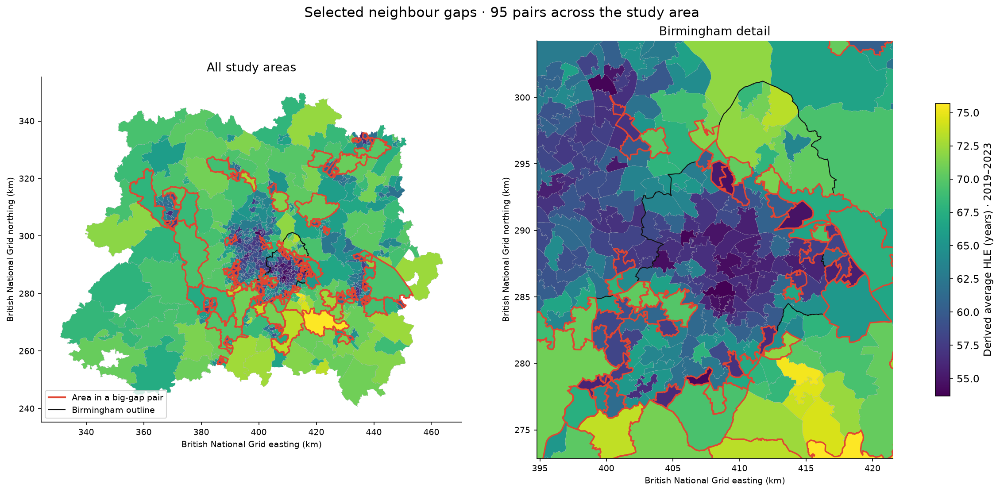

# Birmingham Healthy Life Expectancy

<!-- Visual additions: package badges and project map -->
<p align="center">
  <a href="https://www.python.org/"></a>
  <a href="https://jupyter.org/"></a>
  <a href="https://geopandas.org/"></a>
  <a href="https://pandas.pydata.org/"></a>
  <a href="https://numpy.org/"></a>
  <a href="https://scipy.org/"></a>
  <a href="https://shapely.readthedocs.io/"></a>
  <a href="https://scikit-learn.org/"></a>
  <a href="https://matplotlib.org/"></a>
  <a href="https://ipython.org/"></a>
</p>
<p align="center">
  
</p>
<!-- End visual additions -->

Many data analysis assessment projects use general datasets from Kaggle, on things like credit card churn, car prices or health insurance, and they're fine for us newbies to show off our new skills. I'd been there and done that. I wanted to find a problem that was closer to home, more relevant to me and to those I love, and something I could direct and shape to ask and answer real questions about my here and now.

How many years can you expect to live in good health? In Birmingham and the areas around it, the answer depends a lot on where you live. Across 660 neighbourhoods, healthy life expectancy (HLE) runs from about 54 years to nearly 76. Some places that share a boundary are 14 to 16 years apart. I find that remarkable.

The idea came from a map of the London Tube that showed life expectancy at each station ([*Lives on the Line*](https://jcheshire.com/featured-maps/lives-on-the-line/), by James Cheshire and Oliver O'Brien). Stops a few minutes apart had very different health outcomes. I wanted to see whether my own city did the same. The more I looked, the more I cared about neighbouring areas rather than railway lines. The rail corridor idea became window dressing, not a fundamental part of the investigation, so I dumped it. Instead, I mapped HLE for every small area, tested whether the gaps between neighbours are real or just estimate noise, and then asked what else about an area lines up with them: income, qualifications, work, housing, air quality and crime. Machine learning comes last, to see how much of the pattern those measures account for and where they fall short.

Everything here describes areas, not people. A link between HLE and income in an area doesn't tell you about anyone who lives there, and it doesn't prove a cause.

It's for people who know Birmingham and the places around it, the public and professionals alike. They should recognise the areas by name, read the maps, and relate what they see to what they already know.

## Start here

### [tidyweb.github.io/Birmingham-Healthy-Life](https://tidyweb.github.io/Birmingham-Healthy-Life/)

The website tells the whole story of the project in short illustrated chapters, from the idea to what the data does and doesn't say. It also holds my interactive dashboard of HLE across the 660 areas, which I built in my own code because Tableau couldn't show what I wanted, and you can read all six notebooks there without running anything. This README covers what you need here: the questions, the hypothesis, the dashboards, how to run the notebooks and how I worked.

## What I wanted to find out

These are the questions the project has to answer, and where each one is answered.

1. **How much does healthy life expectancy vary across Birmingham and the areas around it, and where is it lowest?** Notebook 01 ranks every area with its margin of error, and Notebook 03 shows the spread for men and women as histograms. The dashboards map it.
2. **Are the big gaps between neighbouring areas real, or just noise in the estimates?** Notebook 04 compares the real gaps with simulated noise in two distribution charts, tests how alike neighbours are with a permutation chart, and maps the biggest gaps.
3. **What else about an area lines up with its HLE?** Notebook 03 has correlation heatmaps and a grid of scatter plots, one per measure.
4. **How much of HLE can those measures predict, and where do they fall short?** Notebook 05 profiles the groups as a heatmap, compares their HLE in a box plot, shows the regression weights as a bar chart, and maps where the model gets HLE wrong.
5. **What sets the two sides of the sharpest boundaries apart?** Notebook 06 maps the five hotspots and compares the two sides of each pair in bar charts.

## The hypothesis

**H₀:** neighbouring areas don't really differ. The gaps between them come only from the margin of error in the estimates.
**H₁:** neighbouring areas differ by more than that noise can produce.

I tested it in Notebook 04 on all 1,885 pairs of neighbouring areas, against 10,000 simulated runs of pure noise. If the gaps were noise, about 5% of pairs would pass the usual 1.96 line. In the real data, 69.8% do. So I reject H₀: the gaps are real. That tells me they're worth explaining. It doesn't tell me why they happen, which is what Notebooks 05 and 06 go after.

## Dashboards

**Tableau Public: [Birmingham HLE](https://public.tableau.com/views/BirminghamHLEFinal/Dashboard1).** This is my business intelligence dashboard. It reads the joined table that Notebook 03 saves (`data/cleaned/Wide/msoa_wide_660.csv`), so all the cleaning and joining is done in Python first. It has three linked views: a map of HLE by area, a box plot of HLE by local authority, and a scatter of HLE against household income. Clicking an area on the map picks it out in the scatter, and hovering over anything shows the area's name and figures.

**My own dashboard: [on the project website](https://tidyweb.github.io/Birmingham-Healthy-Life/dashboard/).** Tableau did the job, but I couldn't make it behave the way I wanted. It had no 3D, a legend I couldn't pin to the map, a fixed layout and limited colour control. So I built a second dashboard around a Leaflet map. It reads the same saved tables, so the two always agree. It lives on the website, not in this repository, which holds only the Python analysis.

## The notebooks

Run them in order. Each one reads the previous one's saved outputs.

1. [01 Source Exploration](notebooks/A%20%E2%80%94%20Source%20Exploration/01_Source_Exploration.ipynb). The HLE data itself: how my areas compare with the rest of the country, men against women, margins of error, and the first look at gaps between neighbours. The [interactive HLE profile](reports/ydata/hle---msoa-rows.html) goes with it; download it and open it in a browser.
2. [02 Data Preparation](notebooks/B%20%E2%80%94%20Data%20Preparation/02_Data_Preparation.ipynb). Ten datasets cut down to the measures I need, one row per area: HLE, household deprivation, overcrowding, fuel poverty, pollution, economic activity, qualifications, income, ethnicity and recorded crime. It also flags student areas and city-centre visitor hubs.
3. [03 Joined Table and Exploration](notebooks/C%20%E2%80%94%20Joined%20Table%20and%20Exploration/03_Joined_Table_and_Exploration.ipynb). Everything joined into one table, then explored: what moves with HLE, which measures overlap, and a shortlist of seven to take forward.
4. [04 Hypothesis and Neighbour Gaps](notebooks/D%20%E2%80%94%20Hypothesis%20and%20Neighbour%20Gaps/04_Hypothesis_and_Neighbour_Gaps.ipynb). Are the gaps between neighbours real? A test against estimate noise, a check on how much neighbouring areas resemble each other, and the 95 biggest-gap pairs picked by a fixed rule.
5. [05 Machine Learning](notebooks/E%20%E2%80%94%20Machine%20Learning/05_Machine_Learning.ipynb). K-means clustering with HLE held out, then one linear regression tested on local authorities it hasn't seen, and a map of where it gets HLE wrong.
6. [06 Hotspots](notebooks/F%20%E2%80%94%20Hotspots/06_Hotspots.ipynb). I group the 95 big-gap neighbour pairs into patches, compare how often they cross local-authority boundaries, estimate within-authority patterns, and screen Census 2021 characteristics alongside FEAT takeaway rates. These are area-level associations, not causes.

## Repository layout

```
data/
  raw/          untouched source files, in dated folders, with a README
  prepared/     the LSOA-to-MSOA geography lookup
  reference/    familiar local area names and their attribution
  cleaned/      everything the notebooks produce, including Hotspots outputs
  source-register.csv   links, dates, geography, checksums and licences for each source
notebooks/      the notebooks, one folder each (A to F)
reports/ydata/  the interactive HLE profile used in Notebook 01
requirements.txt
```

## Running them

I built and checked these with Python 3.14.7. Install the packages into a virtual environment and select it as the Jupyter kernel:

```bash
python -m pip install -r requirements.txt
```

The notebooks find the `data` folder from wherever they're opened, so nothing depends on my machine's paths. Every source they need is in `data/raw`. Each run overwrites its own outputs in `data/cleaned`.

## Data and sources

- [Raw sources](data/raw/), in dated folders, organised by date and topic, with a [README](data/raw/README.md) and source register.
- [Cleaned tables](data/cleaned/), all keyed on the same 660 MSOA codes.
- [Local area names](data/reference/Area%20Names/), with their attribution.
- [Geography lookup](data/prepared/Geography/), LSOA to MSOA.
- The [source register](data/source-register.csv) records where each source came from, when, and under what licence.

HLE covers 2019 to 2023. The other measures come from 2021 to 2024, so they're not one snapshot in time.

## How I used AI

I used AI throughout this project, at every stage, and it was fundamental to it. Claude was my sounding board for ideas. Google Gemini was my research assistant: we searched for open datasets together, and I rejected most of them as unfit. Codex was my coding partner. I shaped the plans and steps in VS Code, and the code, and the first drafts of much of the wording, came out of working with Codex through a skill I built from what I've learned on this course.

I decided what to look at, which sources to use and what to leave out, and I checked the results, including the ones that added up suspiciously well. I've edited the text so it says what I mean, and every number in it comes from a notebook's own output. Notebook 01 has a section on how I worked.

## What I learned

The longer version is on the website, in [How I worked](https://tidyweb.github.io/Birmingham-Healthy-Life/story/how-i-worked.html).

- **Let the question lead.** I held on to the railway idea too long because it made a good picture. Once I saw that the real question was neighbours, it had to go.
- **Real data never lines up.** Fuel poverty came for smaller areas, pollution as a grid and crime as single records, and the years run from 2019 to 2024. Getting all of it onto the same 660 areas, without bending any of it, was most of the work.
- **Test from a clean copy.** My notebooks ran on my machine and broke in a fresh clone, because of folder names and paths that only existed on my computer. Now I test from a clean copy before I publish.
- **Distrust a result that looks too good.** My Census screen confirmed 81 characteristics. Most of them turned out to be one picture told 81 ways.
- **Tools are a choice.** Tableau got me a working dashboard quickly, but not the one I wanted, so I built my own as well.
- **AI needs directing.** It speeds everything up, but it gets carried away without a firm hand, and checking its numbers is my job.

That's the work as I expect to find it: messy public data, a question that changes as you go, results that have to be checked before anyone acts on them, and tools that come and go. This project made me practise all of it.

## How this repository was built

I developed the notebooks in a working folder on my own machine and published them here a notebook at a time, as each one was finished. That's why some early commits are large: each adds a whole notebook and its outputs, or the raw data. From the final review onwards, each fix has its own commit.

## Ethics

This project uses publicly available, area-level data from public-sector and academic sources. Each source has its own terms; the source register records the licence and attribution information for each one. I didn't collect any data myself. Everything is at MSOA level, where each area holds roughly 5,000 to 15,000 residents, and every figure is a total, rate or estimate for the whole area. The project contains no person-level records. ONS also applies disclosure control to its Census tables, and the police data is anonymised to approximate locations before release.

The one thing I've been careful about is how I describe places, because calling a neighbourhood "unhealthy" could stigmatise the people who live there. So I describe areas and not people, I say links and not causes, and I treat ethnic composition only as a description of who lives in an area for the purpose of investigating culture as a factor in HLE.

## Attribution

The project uses [ONS health state life expectancy estimates](https://www.ons.gov.uk/peoplepopulationandcommunity/healthandsocialcare/healthandlifeexpectancies/datasets/healthstatelifeexpectancyestimatesformiddlelayersuperoutputareasenglandandwales), [ONS small-area income estimates](https://www.ons.gov.uk/employmentandlabourmarket/peopleinwork/earningsandworkinghours/datasets/smallareaincomeestimatesformiddlelayersuperoutputareasenglandandwales), and [Census 2021 tables from Nomis](https://www.nomisweb.co.uk/census/2021/bulk). Other sources include [DESNZ sub-regional fuel poverty statistics](https://www.gov.uk/government/statistics/sub-regional-fuel-poverty-data-2026-2024-data), [Defra modelled pollution data](https://uk-air.defra.gov.uk/data/pcm-data), and [Police.uk crime and anti-social behaviour data](https://data.police.uk/data/). Food-environment data come from the [Food environment assessment tool (Feat)](https://www.feat-tool.org.uk/about), developed by the MRC Epidemiology Unit at the University of Cambridge. Its requested citation is *Food environment assessment tool (Feat) 2023, MRC Epidemiology Unit, University of Cambridge* ([citation guidance](https://www.feat-tool.org.uk/faq)).

The [source register](data/source-register.csv) lists the project files, source and download links, periods, geographies, uses, and recorded licence and attribution notes. Licence terms vary by source; where applicable, public-sector information is used under the [Open Government Licence v3.0](https://www.nationalarchives.gov.uk/doc/open-government-licence/version/3/). The [ONS 2021 MSOA boundaries](https://geoportal.statistics.gov.uk/datasets/ons::middle-layer-super-output-areas-december-2021-boundaries-ew-bgc-v3/about) carry Ordnance Survey attribution.

I adapted my local area names from the [House of Commons Library MSOA Names lookup](https://houseofcommonslibrary.github.io/msoanames/), under the [Open Parliament Licence](https://www.parliament.uk/site-information/copyright-parliament/open-parliament-licence/). The names are display labels; they do not change the official boundaries.

The project idea credits [*Lives on the Line*](https://jcheshire.com/featured-maps/lives-on-the-line/) by James Cheshire and Oliver O'Brien.
